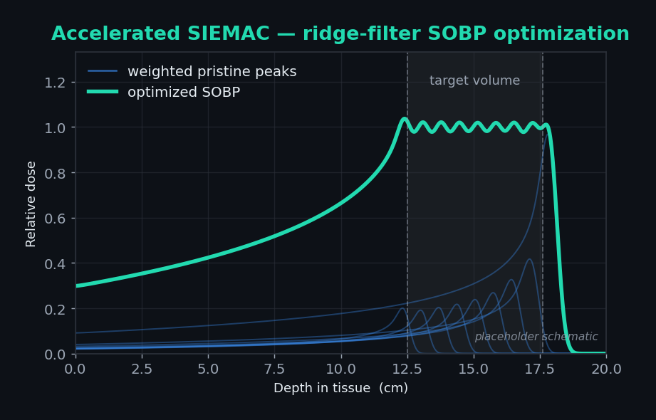
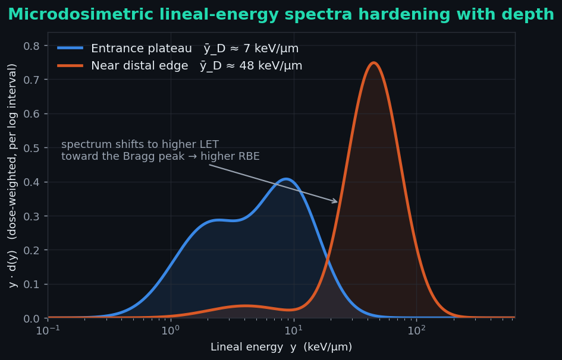
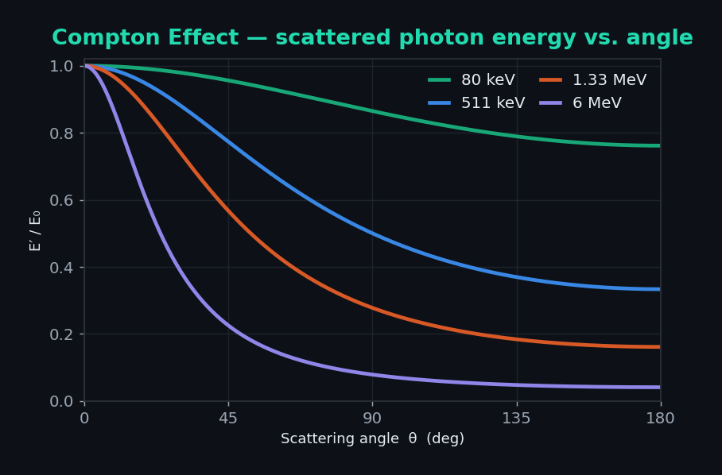

  

---

## 👋 About Me

I'm **Arnav Menon**, a Ph.D. student in the **Nuclear & Radiological Engineering and Medical Physics (NREMP)** program at **Georgia Tech**. I work at the intersection of **computational radiation transport** and **machine learning**, with the goal of making high-fidelity proton therapy simulation fast enough to use inside the clinical loop.

- 🔬 **Research focus** — GPU-accelerated Monte Carlo dose calculation and ML surrogate models (diffusion models, PINNs) for proton therapy.
- 🎯 **Why it matters** — proton therapy spares healthy tissue, but planning it well demands enormous simulation. I build methods that keep the physics accurate while cutting the compute from hours to seconds.
- 🧪 **Toolkit** — `TOPAS` / `Geant4` Monte Carlo, `CUDA`, `PyTorch`, inverse optimization, and microdosimetry.
- 🌱 **Currently** — connecting microdosimetric lineal-energy spectra to variable proton RBE, and accelerating ridge-filter design.
- 📫 **Reach me** — open an issue, or connect — always happy to talk medical physics, Monte Carlo, and ML for science.

---

## 🔬 Research & Project Showcase

<table border="0">
  <tr>
    <td width="33.3%" valign="top">
      
      

        <a href="https://github.com/amenon83/SIEMAC_card"><b>⚡ Accelerated SIEMAC</b></a> 
        Inverse-optimized <b>sparse ridge filter</b> that shapes a pristine proton peak into a flat spread-out Bragg peak — GPU/ML-accelerated.  
        <code>TOPAS</code> <code>CUDA</code> <code>PyTorch</code> <code>Optimization</code>
      

    </td>
    <td width="33.3%" valign="top">
      
      

        <a href="https://github.com/amenon83/lineal-energy"><b>📈 Lineal Energy &amp; Proton RBE</b></a>
         
        Microdosimetric <b>lineal-energy spectra</b> as a mechanistic input to variable proton RBE — a research proposal with a fast ML surrogate.  
        <code>Microdosimetry</code> <code>TOPAS</code> <code>MKM</code> <code>ML</code>
      

    </td>
    <td width="33.3%" valign="top">
      
      

        <a href="https://github.com/amenon83/compton-scattering"><b>🌀 Compton Scattering</b></a> 
        A small, runnable teaching sim of the <b>Compton effect</b>: kinematics, the Klein–Nishina cross section, and a Monte Carlo you can read line by line.  
        <code>Python</code> <code>NumPy</code> <code>Monte&nbsp;Carlo</code> <code>Physics</code>
      

    </td>
  </tr>
</table>

---

## 📡 Medical Physics Feed

The latest <b>physics.med-ph</b> preprints from <a href="https://arxiv.org/list/physics.med-ph/recent">arXiv</a>, auto-refreshed weekly by a GitHub Action. A snapshot of where the field is moving.

<!-- ARXIV-FEED:START -->
**[Deep Learning Reconstruction for Accelerated Radial CEST MR Fingerprinting](https://arxiv.org/abs/2610.23805v1)**  
_Karandeep Cheema, Victor Murray, Ricardo Otazo et al. · 2026-10-16_  
Purpose: To accelerate chemical exchange saturation transfer magnetic resonance fingerprinting (CEST-MRF) using temporal deep learning reconstruction. Methods: Ten healthy volunteers underwent…

**[Localizing and quantifying cerebral arterial stenosis from sparse velocity waveforms using a conditional neural operator](https://arxiv.org/abs/2610.23774v1)**  
_Tong Zhu, Yi Zhu, Jiawei Liu et al. · 2026-10-16_  
Cerebral arterial stenosis alters blood flow throughout the vascular network, complicating the estimation of its location and severity from sparse velocity observations. We developed a conditional…

**[Attenuation corrected activity reconstruction for listmode TOF-PET data](https://arxiv.org/abs/2610.23655v1)**  
_Ahmadreza Rezaei, Suleman Surti, Samuel Matej et al. · 2026-10-16_  
Time-of-flight (TOF) positron emission tomography (PET) emission data allow joint estimation of the activity and attenuation images. The methods proposed so far rely on reconstructions from TOF…

**[Spatiotemporal Adaptive Eigenspectrum Remapping in Transcranial Ultrasound Localization Microscopy](https://arxiv.org/abs/2610.23099v1)**  
_Stephen A Lee, Isidora Jelenkovic, Maia V. Kokoeva et al. · 2026-10-16_  
Clutter suppression is a critical preprocessing step in ultrasound blood flow imaging, yet conventional singular value decomposition (SVD) filtering depends on data-specific eigenvalue cutoffs that…

**[Implementing the EIT complete electrode model through Robin boundary conditions](https://arxiv.org/abs/2610.22944v1)**  
_Bing-Zhou Chen, Amelia Deakin, Andy Adler et al. · 2026-10-16_  
Objective. Medical electrical impedance tomography systems prescribe electrode currents. Accurate voltages, even on passive electrodes, require the complete electrode model (CEM), the most accurate…

**[A single radiation hard pixel detector for proton dosimetry, imaging, energy resolution and beam monitoring](https://arxiv.org/abs/2610.20304v1)**  
_Nico Frederic Brosda, Stephane Higueret, Nicolas Arbor et al. · 2026-10-14_  
Proton therapy enables highly conformal tumour irradiation by exploiting the Bragg peak. Clinical precision relies on detector systems that provide linearity, spatial resolution, radiation hardness…

_Updated: 2026-10-19 · source: arXiv physics.med-ph_
<!-- ARXIV-FEED:END -->

---

## 🐍 My Contribution Trail

  <picture>
    <source media="(prefers-color-scheme: dark)" srcset="https://raw.githubusercontent.com/amenon83/amenon83/output/github-contribution-grid-snake-dark.svg">
    <source media="(prefers-color-scheme: light)" srcset="https://raw.githubusercontent.com/amenon83/amenon83/output/github-contribution-grid-snake.svg">
    
  </picture>

  

