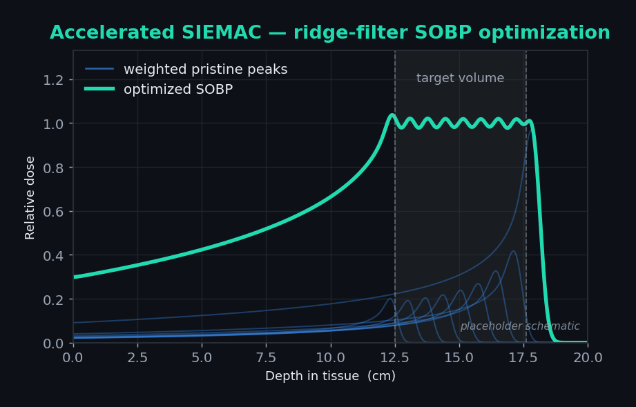

  

---

## 👋 About Me

I'm **Arnav Menon**, a Ph.D. student in the **Nuclear & Radiological Engineering and Medical Physics (NREMP)** program at **Georgia Tech**. I work at the intersection of **computational radiation transport** and **machine learning**, with the goal of making high-fidelity proton therapy simulation fast enough to use inside the clinical loop.

- 🔬 **Research focus** — GPU-accelerated Monte Carlo dose calculation and ML surrogate models (diffusion models, PINNs) for proton therapy.
- 🎯 **Why it matters** — proton therapy spares healthy tissue, but planning it well demands enormous simulation. I build methods that keep the physics accurate while cutting the compute from hours to seconds.
- 🧪 **Toolkit** — `TOPAS` / `Geant4` Monte Carlo, `CUDA`, `PyTorch`, inverse optimization, and microdosimetry.
- 🌱 **Currently** — connecting microdosimetric lineal-energy spectra to variable proton RBE, and accelerating ridge-filter design.
- 📫 **Reach me** — open an issue, or connect — always happy to talk medical physics, Monte Carlo, and ML for science.

---

## 🔬 Research & Project Showcase

<table border="0">
  <tr>
    <td width="33.3%" valign="top">
      
      

        <a href="https://github.com/amenon83/SIEMAC_card"><b>⚡ Accelerated SIEMAC</b></a> 
        Inverse-optimized <b>sparse ridge filter</b> that shapes a pristine proton peak into a flat spread-out Bragg peak — GPU/ML-accelerated.  
        <code>TOPAS</code> <code>CUDA</code> <code>PyTorch</code> <code>Optimization</code>
      

    </td>
    <td width="33.3%" valign="top">
      
      

        <a href="https://github.com/amenon83/lineal-energy"><b>📈 Lineal Energy &amp; Proton RBE</b></a>
         
        Microdosimetric <b>lineal-energy spectra</b> as a mechanistic input to variable proton RBE — a research proposal with a fast ML surrogate.  
        <code>Microdosimetry</code> <code>TOPAS</code> <code>MKM</code> <code>ML</code>
      

    </td>
    <td width="33.3%" valign="top">
      
      

        <a href="https://github.com/amenon83/compton-scattering"><b>🌀 Compton Scattering</b></a> 
        A small, runnable teaching sim of the <b>Compton effect</b>: kinematics, the Klein–Nishina cross section, and a Monte Carlo you can read line by line.  
        <code>Python</code> <code>NumPy</code> <code>Monte&nbsp;Carlo</code> <code>Physics</code>
      

    </td>
  </tr>
</table>

---

## 📡 Medical Physics Feed

The latest <b>physics.med-ph</b> preprints from <a href="https://arxiv.org/list/physics.med-ph/recent">arXiv</a>, auto-refreshed weekly by a GitHub Action. A snapshot of where the field is moving.

<!-- ARXIV-FEED:START -->
**[Receptor Abundance Alone Underpredicts Red Blood Cell Adhesion in Gaucher Disease](https://arxiv.org/abs/2611.27960v1)**  
_Zhaojie Chai, Pierre A. Buffet, Melanie Franco et al. · 2026-11-20_  
Red blood cells (RBCs) in Gaucher disease (GD) adhere abnormally to vessel walls and carry more Lutheran/basal cell adhesion molecule (Lu/BCAM), a laminin receptor. Whether receptor abundance sets…

**[ReCoFlow-MRI: Few-Step Conditional Flow Matching for GNL-Induced Nonlinear MRI Reconstruction](https://arxiv.org/abs/2611.27590v1)**  
_Qidi Luo, Hongli Chen, Jialiang Zhang et al. · 2026-11-20_  
Objective: Accelerated magnetic resonance imaging (MRI) reconstruction is challenging in the presence of gradient nonlinearity (GNL). GNL-induced nonlinear spatial encoding causes geometric…

**[Optical Scintillation Imaging for Dynamic Source Tracking Dosimetry During Prostate HDR Brachytherapy](https://arxiv.org/abs/2611.27146v1)**  
_Kevin Willy, Megan Clark, Petr Bruza et al. · 2026-11-20_  
High-dose-rate (HDR) brachytherapy is highly conformal, but its accuracy depends on catheter and source placement, and clinical workflows lack real-time in vivo dosimetry (IVD) that verifies delivery…

**[Three-Dimensional Ultrasound Localization Microscopy Using Hadamard-Encoded Multipulse and 4D Denoising on a 256-Channel System with a 1024-element Matrix Array: A Feasibility Study in Human Kidney Transplants](https://arxiv.org/abs/2611.26751v1)**  
_U-Wai Lok, Jingke Zhang, Jingyi Yin et al. · 2026-11-19_  
Three-dimensional ultrasound localization microscopy (3D ULM) enables volumetric visualization of microvasculature beyond the acoustic diffraction limit, but its clinical translation remains limited…

**[Transition Dynamics Matter: Hidden Markov Scoring of Epileptogenic Channels in SEEG](https://arxiv.org/abs/2611.26142v1)**  
_Giulia Tacconi, Federico Mason, Lorenzo Ferri et al. · 2026-11-19_  
Stereo-electroencephalography (SEEG) represents the most effective technique for the detection of the Epileptogenic Zone (EZ) in drug-resistant epilepsy. This procedure produces a multi-dimensional…

**[Physics-Informed Deep Learning for Shear Wave Speed Estimation in MR Elastography](https://arxiv.org/abs/2611.26111v1)**  
_Stefan Martin, Jakob Schattenfroh, Patrick Schuenke et al. · 2026-11-19_  
Objective: Magnetic Resonance Elastography (MRE) is a non-invasive imaging technique for mapping biomechanical properties of in vivo tissue, including shear wave speed (SWS), but involves…

_Updated: 2026-11-24 · source: arXiv physics.med-ph_
<!-- ARXIV-FEED:END -->

---

## 🐍 My Contribution Trail

  <picture>
    <source media="(prefers-color-scheme: dark)" srcset="https://raw.githubusercontent.com/amenon83/amenon83/output/github-contribution-grid-snake-dark.svg">
    <source media="(prefers-color-scheme: light)" srcset="https://raw.githubusercontent.com/amenon83/amenon83/output/github-contribution-grid-snake.svg">
    
  </picture>

  

