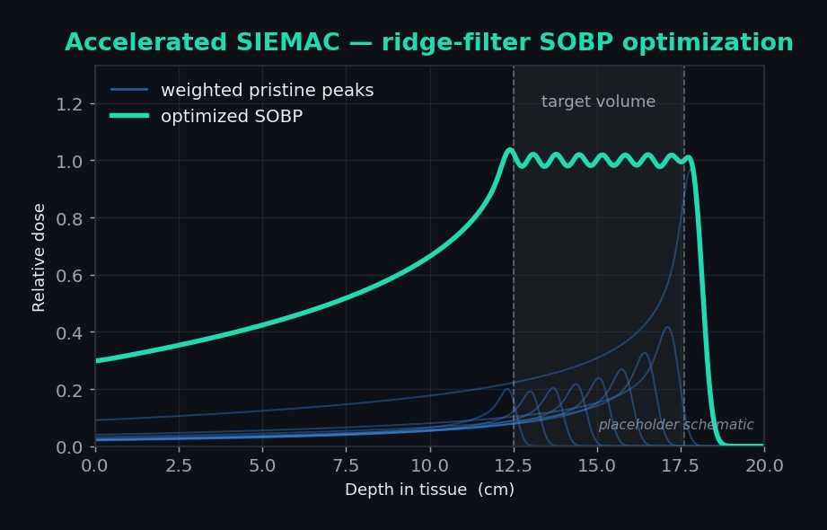
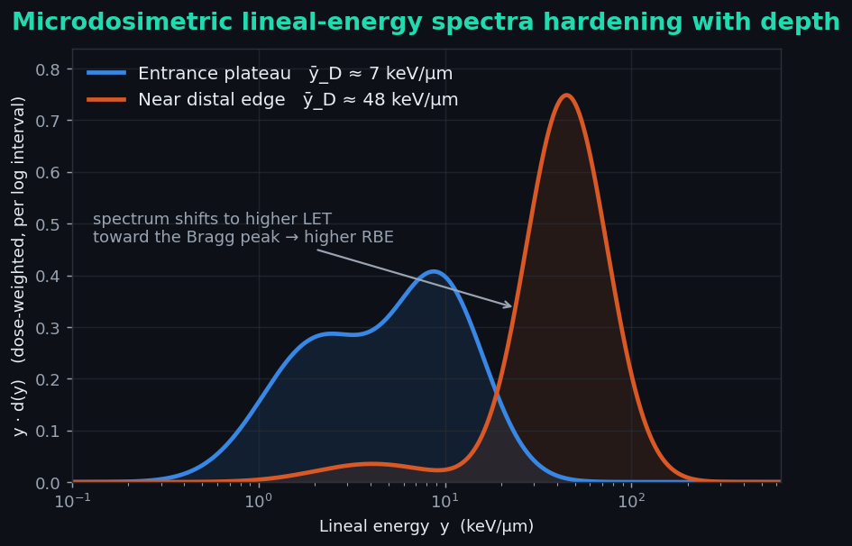
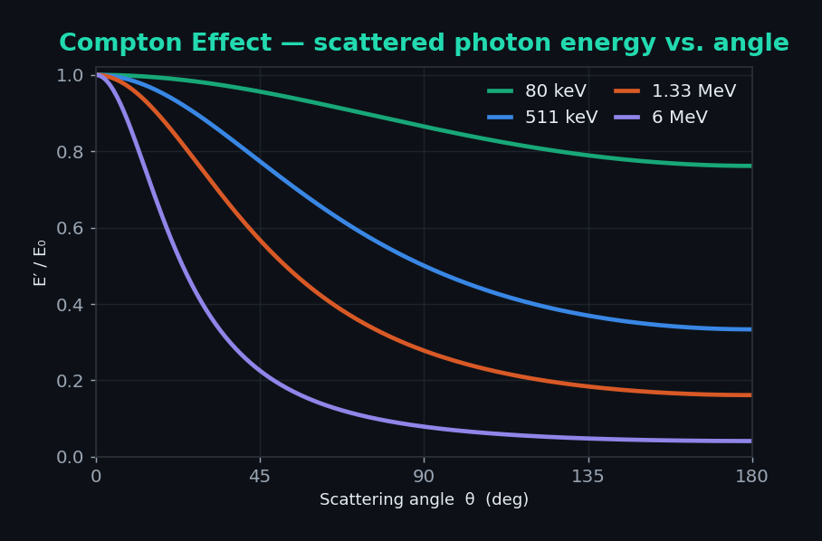

  

---

## 👋 About Me

I'm **Arnav Menon**, a Ph.D. student in the **Nuclear & Radiological Engineering and Medical Physics (NREMP)** program at **Georgia Tech**. I work at the intersection of **computational radiation transport** and **machine learning**, with the goal of making high-fidelity proton therapy simulation fast enough to use inside the clinical loop.

- 🔬 **Research focus** — GPU-accelerated Monte Carlo dose calculation and ML surrogate models (diffusion models, PINNs) for proton therapy.
- 🎯 **Why it matters** — proton therapy spares healthy tissue, but planning it well demands enormous simulation. I build methods that keep the physics accurate while cutting the compute from hours to seconds.
- 🧪 **Toolkit** — `TOPAS` / `Geant4` Monte Carlo, `CUDA`, `PyTorch`, inverse optimization, and microdosimetry.
- 🌱 **Currently** — connecting microdosimetric lineal-energy spectra to variable proton RBE, and accelerating ridge-filter design.
- 📫 **Reach me** — open an issue, or connect — always happy to talk medical physics, Monte Carlo, and ML for science.

---

## 🔬 Research & Project Showcase

<table border="0">
  <tr>
    <td width="33.3%" valign="top">
      
      

        <a href="https://github.com/amenon83/SIEMAC_card"><b>⚡ Accelerated SIEMAC</b></a> 
        Inverse-optimized <b>sparse ridge filter</b> that shapes a pristine proton peak into a flat spread-out Bragg peak — GPU/ML-accelerated.  
        <code>TOPAS</code> <code>CUDA</code> <code>PyTorch</code> <code>Optimization</code>
      

    </td>
    <td width="33.3%" valign="top">
      
      

        <a href="https://github.com/amenon83/lineal-energy"><b>📈 Lineal Energy &amp; Proton RBE</b></a>
         
        Microdosimetric <b>lineal-energy spectra</b> as a mechanistic input to variable proton RBE — a research proposal with a fast ML surrogate.  
        <code>Microdosimetry</code> <code>TOPAS</code> <code>MKM</code> <code>ML</code>
      

    </td>
    <td width="33.3%" valign="top">
      
      

        <a href="https://github.com/amenon83/compton-scattering"><b>🌀 Compton Scattering</b></a> 
        A small, runnable teaching sim of the <b>Compton effect</b>: kinematics, the Klein–Nishina cross section, and a Monte Carlo you can read line by line.  
        <code>Python</code> <code>NumPy</code> <code>Monte&nbsp;Carlo</code> <code>Physics</code>
      

    </td>
  </tr>
</table>

---

## 📡 Medical Physics Feed

The latest <b>physics.med-ph</b> preprints from <a href="https://arxiv.org/list/physics.med-ph/recent">arXiv</a>, auto-refreshed weekly by a GitHub Action. A snapshot of where the field is moving.

<!-- ARXIV-FEED:START -->
**[SmartBloch-Agent: An Agentic Framework for Automated MRI Sequence Design and Optimization](https://arxiv.org/abs/2611.09413v1)**  
_Jiakai Yang, Haoye Zheng, Yixiao Yue et al. · 2026-11-06_  
Magnetic resonance imaging (MRI) pulse sequences organize radiofrequency excitation, gradient encoding, and signal acquisition, determining magnetization evolution and image formation. Sequence…

**[Smart Spectral Doppler Ultrasound Imaging using Motion Tracking based on Wide-beam transmission and Neural Networks: Preliminary Results](https://arxiv.org/abs/2611.09002v1)**  
_Jihye Baek, Allison Lee, Jinbum Kang et al. · 2026-11-06_  
Ultrasound spectral Doppler imaging provides quantitative blood flow information for vascular diagnosis, but its accuracy is limited by the one-dimensional (1D) sample volume (SV). Motion from…

**[Dual-energy cardiac DSA imaging using a dual-layer flat-panel detector: in vivo validation study](https://arxiv.org/abs/2611.08820v1)**  
_Yuhang Tan, Jiongtao Zhu, Xin Zhang et al. · 2026-11-06_  
Background: The temporal misregistration in conventional X-ray digital subtraction angiography (DSA) remains a key challenge for its practical application in cardiac catheterization, leading to…

**[Medical Radioisotopes: Supply-chain Resilience, Distributed Production, and Access](https://arxiv.org/abs/2611.08734v1)**  
_David McClain, Daniel Winklehner, Faraz Farhadi et al. · 2026-11-05_  
Over 50 million diagnostic procedures involving medical radioisotopes are performed per year and the number of therapeutic and theranostic agents continues to climb. Yet, the global supply chain is…

**[Medical Radioisotopes: Clinical Demand, Production Physics, and Untapped Pathways](https://arxiv.org/abs/2611.08727v1)**  
_Jarrett Moon, Claire Huchthausen, Jose R Alonso et al. · 2026-11-05_  
Over 40 radioisotopes are currently in use or under development across virtually all fields of modern medicine. Their availability relies on a complex interplay of nuclear physics, radiochemistry…

**[High resolution 3D localization of ultrasound sparse sources using a SAGE algorithm](https://arxiv.org/abs/2611.07966v1)**  
_Sophie V. Heymans, François Rottenberg, Tatiana Gelvez-Barrera et al. · 2026-11-05_  
Reliable localization and characterization of cavitation activity are central to many ultrasound imaging and therapy monitoring applications. Passive acoustic mapping (PAM) can estimate cavitation…

_Updated: 2026-11-09 · source: arXiv physics.med-ph_
<!-- ARXIV-FEED:END -->

---

## 🐍 My Contribution Trail

  <picture>
    <source media="(prefers-color-scheme: dark)" srcset="https://raw.githubusercontent.com/amenon83/amenon83/output/github-contribution-grid-snake-dark.svg">
    <source media="(prefers-color-scheme: light)" srcset="https://raw.githubusercontent.com/amenon83/amenon83/output/github-contribution-grid-snake.svg">
    
  </picture>

  

