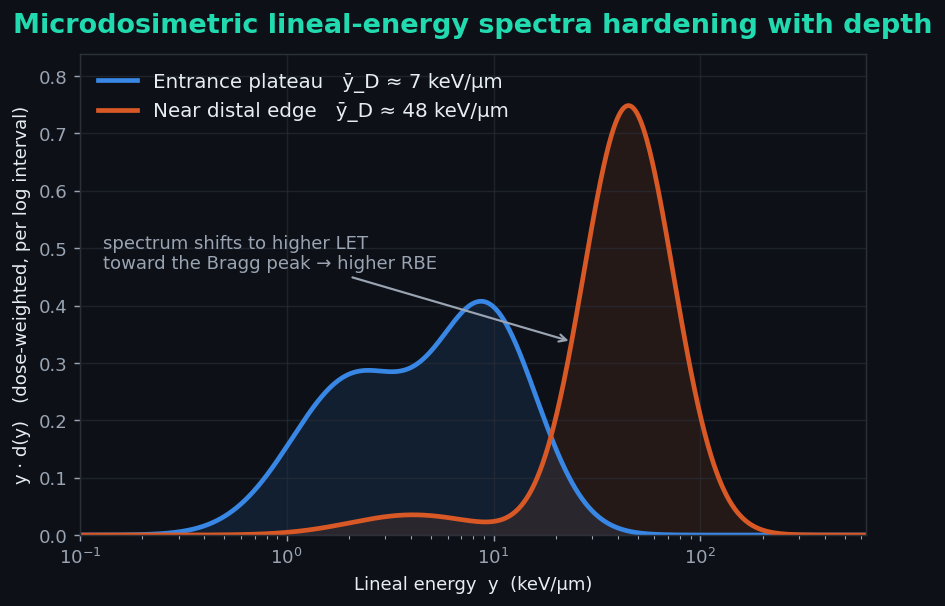
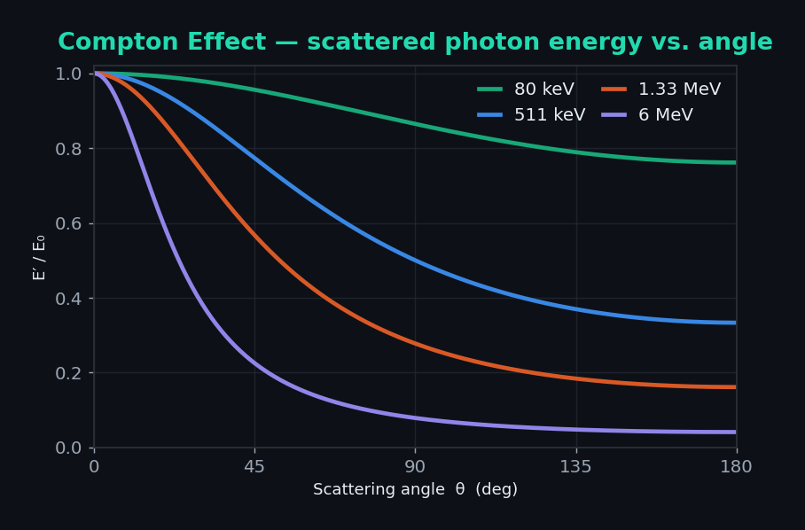

  

---

## 👋 About Me

I'm **Arnav Menon**, a Ph.D. student in the **Nuclear & Radiological Engineering and Medical Physics (NREMP)** program at **Georgia Tech**. I work at the intersection of **computational radiation transport** and **machine learning**, with the goal of making high-fidelity proton therapy simulation fast enough to use inside the clinical loop.

- 🔬 **Research focus** — GPU-accelerated Monte Carlo dose calculation and ML surrogate models (diffusion models, PINNs) for proton therapy.
- 🎯 **Why it matters** — proton therapy spares healthy tissue, but planning it well demands enormous simulation. I build methods that keep the physics accurate while cutting the compute from hours to seconds.
- 🧪 **Toolkit** — `TOPAS` / `Geant4` Monte Carlo, `CUDA`, `PyTorch`, inverse optimization, and microdosimetry.
- 🌱 **Currently** — connecting microdosimetric lineal-energy spectra to variable proton RBE, and accelerating ridge-filter design.
- 📫 **Reach me** — open an issue, or connect — always happy to talk medical physics, Monte Carlo, and ML for science.

---

## 🔬 Research & Project Showcase

<table border="0">
  <tr>
    <td width="33.3%" valign="top">
      
      

        <a href="https://github.com/amenon83/SIEMAC_card"><b>⚡ Accelerated SIEMAC</b></a> 
        Inverse-optimized <b>sparse ridge filter</b> that shapes a pristine proton peak into a flat spread-out Bragg peak — GPU/ML-accelerated.  
        <code>TOPAS</code> <code>CUDA</code> <code>PyTorch</code> <code>Optimization</code>
      

    </td>
    <td width="33.3%" valign="top">
      
      

        <a href="https://github.com/amenon83/lineal-energy"><b>📈 Lineal Energy &amp; Proton RBE</b></a>
         
        Microdosimetric <b>lineal-energy spectra</b> as a mechanistic input to variable proton RBE — a research proposal with a fast ML surrogate.  
        <code>Microdosimetry</code> <code>TOPAS</code> <code>MKM</code> <code>ML</code>
      

    </td>
    <td width="33.3%" valign="top">
      
      

        <a href="https://github.com/amenon83/compton-scattering"><b>🌀 Compton Scattering</b></a> 
        A small, runnable teaching sim of the <b>Compton effect</b>: kinematics, the Klein–Nishina cross section, and a Monte Carlo you can read line by line.  
        <code>Python</code> <code>NumPy</code> <code>Monte&nbsp;Carlo</code> <code>Physics</code>
      

    </td>
  </tr>
</table>

---

## 📡 Medical Physics Feed

The latest <b>physics.med-ph</b> preprints from <a href="https://arxiv.org/list/physics.med-ph/recent">arXiv</a>, auto-refreshed weekly by a GitHub Action. A snapshot of where the field is moving.

<!-- ARXIV-FEED:START -->
**[Scan-specific k-space interpolation using deep Koopman autoencoders](https://arxiv.org/abs/2611.18301v1)**  
_Wassim Ben Salah, Jon Cleary, Sarah McElroy et al. · 2026-11-13_  
Purpose: To develop a scan-specific, interpretable k-space interpolation technique for the reconstruction of accelerated MRI data. Methods: A deep Koopman autoencoder for nonlinear k-space…

**[Certificate-Based Verification of Pulsed Field Ablation Models](https://arxiv.org/abs/2611.18148v1)**  
_Konstantinos Dovelos · 2026-11-13_  
Computational models of pulsed field ablation predict the lesion as the tissue where the electric field exceeds a lethal threshold. Their numerical error is rarely bounded, and automated pipelines…

**[Reproduction of Simulated Acoustics Scenes Using Acoustics Room Transformer for speech intelligibility tests in Clinics](https://arxiv.org/abs/2611.18103v1)**  
_Ali Fallah, Kirsten C Wagener, Pascal Pflueger et al. · 2026-11-13_  
An Acoustic Room Transformation (ART) method is proposed for clinical applications to render simulated acoustic environments using six loudspeakers in a reverberant room. In typical clinical…

**[A Multiobjective Optimization Framework for Sensor Array Design in Magnetocardiography](https://arxiv.org/abs/2611.17976v1)**  
_Kesavaraja C, Sammita Kashyap, Korak Biswas et al. · 2026-11-13_  
Magnetocardiography (MCG) noninvasively measures cardiac magnetic fields. Conventional cryogenic systems use fixed multichannel arrays, whereas room-temperature sensors enable flexible placement to…

**[A thorough review on Deep Learning approaches to 2D-to-3D Registration in Medical Imaging](https://arxiv.org/abs/2611.17468v1)**  
_Andrea Borghesi, Julia van Beurden, Maarten van Alphen et al. · 2026-11-12_  
2D-to-3D image registration is a key component for several medical imaging purposes such as intraoperative guidance, enabling the alignment between preoperative 3D volumes and real-time 2D images…

**[A Feasibility Study of Whole-Cerebrum Task-Based fMRI at 0.55 T: Motor and Visual Tasks Using Single-Shot EPI](https://arxiv.org/abs/2611.17211v1)**  
_Parsa Razmara, Takfarinas Medani, Anand A. Joshi et al. · 2026-11-12_  
Purpose: To evaluate the feasibility of whole-cerebrum task-based fMRI on a modern 0.55T system, examining the effects of extended scan duration and within-session consistency on functional mapping…

_Updated: 2026-11-16 · source: arXiv physics.med-ph_
<!-- ARXIV-FEED:END -->

---

## 🐍 My Contribution Trail

  <picture>
    <source media="(prefers-color-scheme: dark)" srcset="https://raw.githubusercontent.com/amenon83/amenon83/output/github-contribution-grid-snake-dark.svg">
    <source media="(prefers-color-scheme: light)" srcset="https://raw.githubusercontent.com/amenon83/amenon83/output/github-contribution-grid-snake.svg">
    
  </picture>

  

